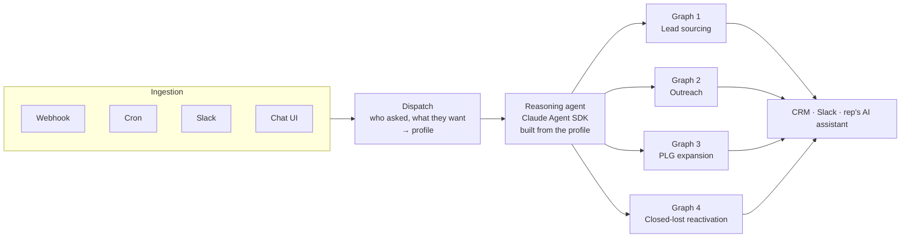
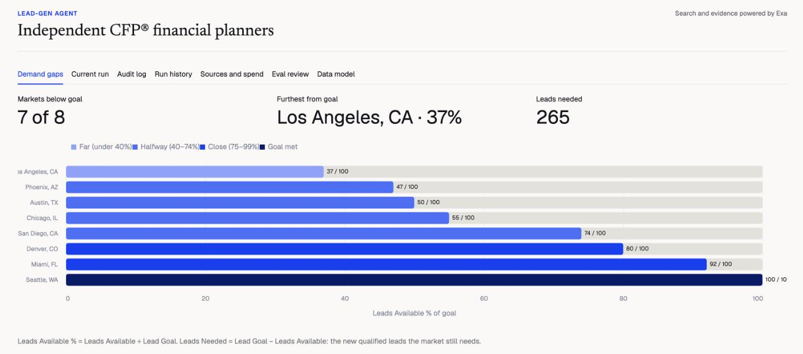
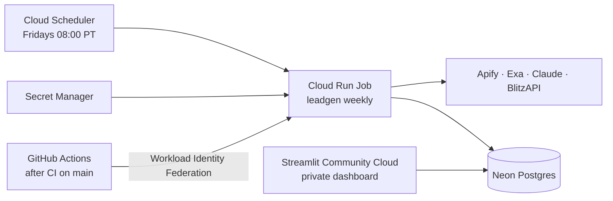

# Applied AI portfolio: GTM agent

AI systems that run go-to-market work end to end for marketing, sales, CX, and support teams,
built on Claude. Mostly deterministic pipelines with agentic steps: plain code does everything
predictable, and the model makes only the judgment calls.

This repository is being rebuilt, in small steps, around one project: the **GTM agent**. It will
be one brain that receives every request, works out who is asking and what they want, and hands
the work to durable workflows (graphs), one per job.

## Where it stands today

**The GTM agent does not run yet.** Step 1 (restructuring the repo) is done. Everything else is
still to build. What exists:

| Folder | What's there now | What's missing |
|---|---|---|
| [`gtm_agent/`](gtm_agent/) | My [Python coding harness](past_builds/vercel_coding_harness/) (Claude Agent SDK), hosted on Cloud Run and reachable from Slack (@mention or DM), redeployed on every merge. It still behaves as a coding assistant: a CLI and a local web UI; a Sonnet parent agent with Haiku explorer and executor subagents; tools for reading, searching, bash, todos, questions, and skills; three approval modes; a local or throwaway sandbox; and token and cost logging per step. | Everything GTM-specific: no CRM or enrichment tools, no Slack buttons; no front door or dispatcher; no profiles (settings come from startup flags); no saved state (conversations and pending approvals live in memory and are lost on restart); no way to start a graph. |
| [`gtm_agent_graphs/`](gtm_agent_graphs/) | Two folders, `leadgen/` and `outreach/`, each holding only a README that describes the planned graph. | All code. Neither graph exists yet. |
| [`past_builds/`](past_builds/) | Five finished projects, including the [leadgen pipeline](past_builds/leadgen_pipeline_agents/), which runs in production every week. | Nothing; these are complete. The leadgen pipeline is not connected to the GTM agent; it is the reference that graph 1 will be rebuilt from. |

So the honest summary: **a working coding-agent skeleton, two empty graph folders, and one
production pipeline that sits alongside them.** The roadmap below turns the skeleton into the
brain and fills in the graphs, one step at a time.

## Target architecture



Each layer, what it will do, what exists today, and the roadmap step that builds it:

| Layer | Target | Today | Step |
|---|---|---|---|
| **1. Ingestion** | Every request (webhook, cron, Slack, chat UI) arrives through one front door. | Slack (`POST /slack/events` on Cloud Run) plus the harness's CLI and local web UI. No webhook or cron entry, and no queue yet. | 1, 5 |
| **2. Dispatch** | Each request is classified by who asked and what they want, then given a profile: permissions, tools, subagents, sandbox, approval mode, and budget. | None. Every run gets the same setup, chosen by startup flags. | 2, 3 |
| **3. Reasoning agent** | One main agent (Claude Agent SDK) is built fresh from that profile. It plans, decides, and hands the work to the right graph. | The agent loop exists (parent plus subagents), but it is built once at startup, has only coding tools, and cannot start a graph. The web server already builds agent options per request, which is the seed of the factory. | 2, 4 |
| **4. Graphs** | Durable workflows, one per job. Minimize LLM calls, maximize plain code. | None in `gtm_agent_graphs/`. The shipped leadgen pipeline shows the pattern (fixed Python stages, a Postgres job queue, checkpoints, two bounded agents) and is the reference for graph 1. | 8, 9, 10 |
| **5. Shared layer** | Subagents keep context clean; every tool has a contract and capped output; prompts are cached; every decision (tools, tokens, cost) is logged; writes and spend need approval at first; failures and human corrections become evals. | Partly there, from the harness: subagents with their own context, tool contracts and capped output, prompt caching, per-step token and cost logging (printed, not stored), and per-command approval. Missing: stored traces, budget reservations, audit logging, and evals. | 4, 6, 11 |
| **6. Delivery** | Output goes where reps already work: the CRM, Slack, or their AI assistant. | Answers are posted in the Slack thread (plain text, no buttons yet), or in the terminal or local web UI. | 7, 9 |

## Use cases

| # | Use case | Example request | Graph | Status |
|---|---|---|---|---|
| 1 | Lead sourcing and qualifying | "Source 20 leads in Denver" | [`gtm_agent_graphs/leadgen/`](gtm_agent_graphs/leadgen/) | Placeholder; planned (steps 8, 9) |
| 2 | Outreach, call prep and follow-up | "Create outreach for the 20 leads" (drafts in each rep's style, approved in Slack) | [`gtm_agent_graphs/outreach/`](gtm_agent_graphs/outreach/) (LangGraph) | Placeholder; planned (step 10) |
| 3 | PLG new opportunity and expansion from product usage | "Which accounts are ready to expand?" | Not started | Later |
| 4 | Closed-lost reactivation and churn response | "Who should we re-engage this quarter?" | Not started | Later |

## Status and roadmap

The full plan, with a before and after for each item, is in
[`gtm_agent/future_work/ROADMAP.md`](gtm_agent/future_work/ROADMAP.md).

| Step | What | Status |
|---|---|---|
| ✅ | Repo restructure; the harness live in Slack on Cloud Run, deployed on every merge | Done |
| 1 | Clean front door: `app.py` entry point, Slack formatting, one answer per message | Next |
| 2 | Brain → GTM: one factory for agent settings, GTM prompt and tools | Planned |
| 3 | Dispatch placeholder: each request gets a saved profile | Planned |
| 4 | State and tracing: Postgres (sessions, follow-ups), LangSmith, cost ledger | Planned |
| 5 | Durable runs: Cloud Tasks | Planned |
| 6 | Shared rules as hooks: approvals, budget reservations, audit logging | Planned |
| 7 | Slack interactions: buttons, questions, status updates, cost footer | Planned |
| 8 | Graph 1, lead sourcing with fake providers | Planned |
| 9 | Live providers and Salesforce: "source 20 leads in Denver" for real | Planned |
| 10 | Graph 2, outreach and style memory | Planned |
| 11 | Measurement and evals: volume, usage, quality, time saved, outcomes | Planned |

Each step lands as its own pull request, so the history shows how the harness changes from a
coding assistant into the GTM agent.

## Repository layout

```
gtm_agent/          the brain: the Python coding harness, live in Slack on Cloud Run
gtm_agent_graphs/   one folder per graph: leadgen/ and outreach/ (placeholders today)
past_builds/        finished projects, each self-contained with its own README
```

## Past builds

| Project | What it is | Status |
|---|---|---|
| [Leadgen pipeline agents](past_builds/leadgen_pipeline_agents/) | Autonomous lead-generation pipeline: finds the markets furthest below goal, plans and prices sourcing, gets one approval, then sources (Google Maps, Exa), dedupes, enriches, qualifies with cited evidence, and writes to the CRM within a budget. Two bounded Claude Agent SDK agents | Live: weekly on Google Cloud |
| [Vercel coding harness](past_builds/vercel_coding_harness/) | A coding-agent harness built twice (Vercel AI SDK and Claude Agent SDK): tool contracts, approval modes, swappable sandbox, context management, explorer and executor subagents, skills, tool registry, web UI | Course build, extended; the Python version is the starting point for `gtm_agent/` |
| [Vercel filesystem agent](past_builds/vercel_filesystem_agent/) | An agent that answers questions about sales-call transcripts by running bash in a Vercel Sandbox | Course build, deployed on Vercel |
| [Research agent, three frameworks](past_builds/research-agent-three-frameworks/) | A research agent that decides, with cited evidence, whether a business takes online orders; the same task in the Claude Agent SDK, Vercel AI SDK, and OpenAI SDK | Course I wrote (Repository 2) |
| [Semi-automated leadgen skills](past_builds/semi-automated-leadgen-skills/) | A source → enrich → qualify → outreach pipeline in plain Python plus Claude Code skills, with human review of uncertain cases | Course I wrote (Repository 1) |

## Leadgen in production

The shipped leadgen pipeline is the reference for graph 1. It keeps running from
`past_builds/leadgen_pipeline_agents/`, separate from the GTM agent, until graph 1 replaces it.





- **Schedule:** Cloud Scheduler starts a Cloud Run Job every Friday. It checks the database is
  migrated and no paid call is unreconciled, plans the biggest gap, approves it under a standing
  policy with a budget cap, runs the pipeline, and exits with a code meaning success, nothing to
  do, needs a person, or error.
- **State:** everything lives in Neon Postgres, with separate least-privilege logins for the job,
  the dashboard, and migrations.
- **Secrets and deploys:** Google Secret Manager; after CI passes on `main`, GitHub Actions signs
  in with a short-lived token, builds the image, migrates, and points the job at it.

**Results:** three live runs (Phoenix, Los Angeles, San Diego) qualified 104 leads with cited
evidence for $9.72 in total, about $0.09 per qualified lead. The scheduled San Diego run found 137
new businesses, qualified 45, and wrote 44 to the CRM for $3.20 of a $5 budget.
