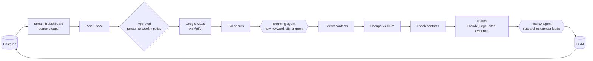
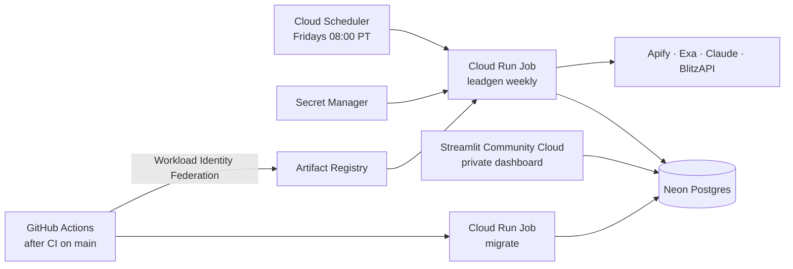

# Applied AI portfolio

Production AI systems for go-to-market work, built on Claude. Each project is a self-contained
folder with its own README, design doc, tests and dependencies.

| Project | What it is | Status |
|---|---|---|
| [Leadgen pipeline agents](leadgen_pipeline_agents/) | An autonomous lead-generation pipeline with two bounded agents: finds the markets furthest below their lead goal, plans and prices the sourcing, gets one approval, then sources, dedupes, enriches, qualifies with cited evidence, and writes qualified leads to the CRM, within a budget | Running weekly on Google Cloud |

## Leadgen pipeline agents: full-stack architecture

A deterministic Python pipeline runs every stage in a fixed order. The Claude Agent SDK is used
only where the next step is not known in advance: two bounded agents, each limited by a PreToolUse
hook to the tools, options and budget the approval allows.

| Layer | What it does | Built with |
|---|---|---|
| Frontend | Demand gaps, live run status, run history, audit log, sources and spend, eval labeling | Streamlit |
| Orchestration | Fixed stage order with checkpoints; a stage gate checks order and budget before each stage; nothing paid runs twice | Python, Postgres state |
| Agents | Sourcing agent adapts Google Maps keywords and cities and Exa queries when planned sourcing falls short; review agent researches leads the judge could not decide | Claude Agent SDK, in-process MCP tools, PreToolUse hooks |
| Sourcing and evidence | Business search, page text for evidence, contact enrichment | Apify (Google Maps), Exa, BlitzAPI |
| Judgment | One structured call per lead returns a verdict, reason and exact quote; code checks the quote appears in the cited page | Claude API structured outputs |
| Data | CRM, plans, approvals, run state, job queue, page cache, cost ledger, traces, evals: one database | Postgres (Neon), numbered migrations |
| Cost control | Every paid call reserves its ceiling against the approved budget first; actual cost is ledgered per call | Postgres reservations and cost ledger |
| Evals | Sample purity per keyword, qualification rate, cost per qualified lead, human-labeled judge decisions exported as test fixtures | Postgres, Streamlit, pytest |
| Quality gates | Lint, format, secret scanning, migrations, 500+ tests with faked providers (CI never spends) | pytest, ruff, gitleaks, GitHub Actions |

## Production deployment

- **Schedule:** Cloud Scheduler starts a Cloud Run Job every Friday. It runs `leadgen weekly`:
  checks the database is migrated and no paid call is unreconciled, plans the biggest gap,
  approves it under a standing policy (budget cap, recorded as the policy's version), runs the
  pipeline, and exits with a code that says success, nothing to do, needs a person, or error.
- **State:** the container is disposable; everything lives in Neon Postgres, with separate
  least-privilege logins for the job, the dashboard and migrations.
- **Secrets:** Google Secret Manager, injected at start; no keys in GitHub.
- **Deploys:** after CI passes on `main`, GitHub Actions signs in to Google with a short-lived
  token (no stored keys), builds the image tagged with the commit, migrates the database, and
  points the job at the new image.
- **Dashboard:** a private Streamlit Community Cloud app, viewers invited by email.
- **Cost:** hosting fits free tiers; provider spend per run is capped by the policy budget.

## Results from scheduled runs

- San Diego, 2026-11-06: 137 new businesses, 45 qualified with cited evidence, 44 written to the
  CRM, 3.20 USD of a 5 USD budget (about 0.07 USD per qualified lead).
- Every run is reproducible from its ledger and audit trail: which stages ran, what each agent
  decided, and what each call cost.

Details: [project README](leadgen_pipeline_agents/README.md),
[design](leadgen_pipeline_agents/docs/design.md),
[operations runbook](leadgen_pipeline_agents/docs/operations.md),
[architecture maps](leadgen_pipeline_agents/docs/architecture/README.md).
