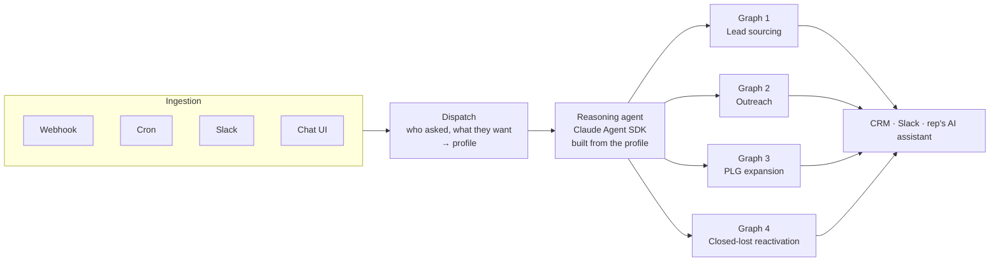
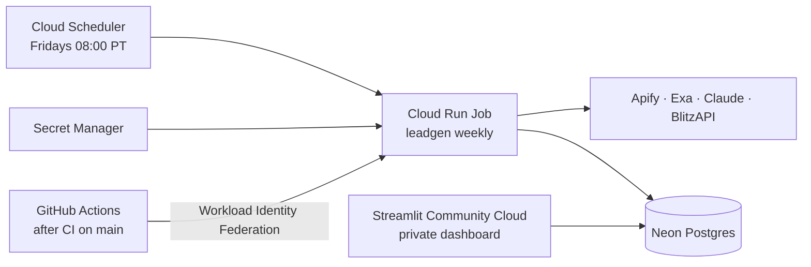

# Applied AI portfolio: GTM agent

AI systems that run go-to-market work end to end for marketing, sales, CX, and support teams,
built on Claude. Mostly deterministic pipelines with agentic steps: plain code does everything
predictable, and the model makes only the judgment calls.

This repository is being rebuilt around one project, the **GTM agent**: one brain that receives
every request, decides what it is and who is asking, and hands the work to durable workflows
(graphs), one per job.

## Architecture



1. **Ingestion:** every request (webhook, cron, Slack, chat UI) arrives through one front door.
2. **Dispatch:** each request is classified by who asked and what they want, then given a
   profile: permissions, tools, subagents, sandbox, approval mode, and budget.
3. **Reasoning agent:** one main agent (Claude Agent SDK) is built fresh from that profile. It
   plans, decides, and hands the work to the right graph.
4. **Graphs:** durable workflows, one per job. Minimize LLM calls, maximize plain code.
5. **Shared layer:** subagents keep context clean; every tool has a contract and capped output;
   prompts are cached; every decision (tools, tokens, cost) is logged; writes and spend need
   approval at first; failures and human corrections become evals.
6. **Delivery:** output goes where reps already work: the CRM, Slack, or their AI assistant.

## Use cases

| # | Use case | Example request | Graph |
|---|---|---|---|
| 1 | Lead sourcing and qualifying | "Source 20 leads in Denver" | [`gtm_agent_graphs/leadgen/`](gtm_agent_graphs/leadgen/) |
| 2 | Outreach, call prep and follow-up | "Create outreach for the 20 leads" (drafts in each rep's style, approved in Slack) | [`gtm_agent_graphs/outreach/`](gtm_agent_graphs/outreach/) (LangGraph) |
| 3 | PLG new opportunity and expansion from product usage | "Which accounts are ready to expand?" | Planned |
| 4 | Closed-lost reactivation and churn response | "Who should we re-engage this quarter?" | Planned |

## Repository layout

```
gtm_agent/          the brain: starts as an exact copy of the Python coding harness, then
                    evolves step by step into the GTM agent
gtm_agent_graphs/   one folder per graph (leadgen, outreach)
past_builds/        shipped and course projects, each self-contained with its own README
```

## Status and roadmap

| Step | What | Status |
|---|---|---|
| 1 | Restructure the repo into `gtm_agent/`, `gtm_agent_graphs/`, and `past_builds/` | Done |
| 2 | Shared Postgres foundation: threads, sessions, approvals, graph runs, traces tagged by job | Next |
| 3 | Front door and dispatcher: one entry point, request classified into a profile | Planned |
| 4 | Factory and profiles: the agent's tools, subagents, model, sandbox, and approvals come from the profile | Planned |
| 5 | Shared rules as hooks: approvals, budget reservations, audit logging | Planned |
| 6 | Graph 1, lead sourcing: "source 20 leads in Denver", rebuilt from the shipped leadgen pipeline | Planned |
| 7 | Graph 2, outreach (LangGraph): one draft per lead in the assigned rep's style | Planned |
| 8 | Slack approval cards: send, edit, or cancel each draft | Planned |
| 9 | Style memory: each rep's edits (draft → edit → sent) update their style notes | Planned |
| 10 | Measurement and evals: volume, usage, quality, time saved, and outcomes per graph | Planned |

## Past builds

| Project | What it is | Status |
|---|---|---|
| [Leadgen pipeline agents](past_builds/leadgen_pipeline_agents/) | Autonomous lead-generation pipeline: finds the markets furthest below goal, plans and prices sourcing, gets one approval, then sources (Google Maps, Exa), dedupes, enriches, qualifies with cited evidence, and writes to the CRM within a budget. Two bounded Claude Agent SDK agents | Live: weekly on Google Cloud |
| [Vercel coding harness](past_builds/vercel_coding_harness/) | A coding-agent harness built twice (Vercel AI SDK and Claude Agent SDK): tool contracts, approval modes, swappable sandbox, context management, explorer and executor subagents, skills, tool registry, web UI | Course build, extended; the Python version seeds `gtm_agent/` |
| [Vercel filesystem agent](past_builds/vercel_filesystem_agent/) | An agent that answers questions about sales-call transcripts by running bash in a Vercel Sandbox | Course build, deployed on Vercel |
| [Research agent, four frameworks](past_builds/research-agent-four-frameworks/) | A research agent that decides, with cited evidence, whether a business takes online orders; the same task in the Claude Agent SDK, Vercel AI SDK, and OpenAI SDK | Course I wrote (Repository 2) |
| [Semi-automated leadgen skills](past_builds/semi-automated-leadgen-skills/) | A source → enrich → qualify → outreach pipeline in plain Python plus Claude Code skills, with human review of uncertain cases | Course I wrote (Repository 1) |

## Leadgen in production

The shipped leadgen pipeline is the reference for graph 1. It keeps running from
`past_builds/leadgen_pipeline_agents/`, separate from the GTM agent, until graph 1 replaces it.




- **Schedule:** Cloud Scheduler starts a Cloud Run Job every Friday. It checks the database is
  migrated and no paid call is unreconciled, plans the biggest gap, approves it under a standing
  policy with a budget cap, runs the pipeline, and exits with a code meaning success, nothing to
  do, needs a person, or error.
- **State:** everything lives in Neon Postgres, with separate least-privilege logins for the job,
  the dashboard, and migrations.
- **Secrets and deploys:** Google Secret Manager; after CI passes on `main`, GitHub Actions signs
  in with a short-lived token, builds the image, migrates, and points the job at it.

**Results:** three live runs (Phoenix, Los Angeles, San Diego) qualified 104 leads with cited
evidence for $9.72 in total, about $0.09 per qualified lead. The scheduled San Diego run found 137
new businesses, qualified 45, and wrote 44 to the CRM for $3.20 of a $5 budget.
