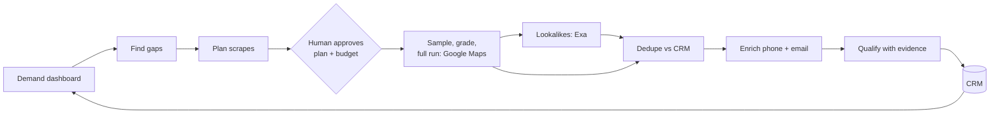
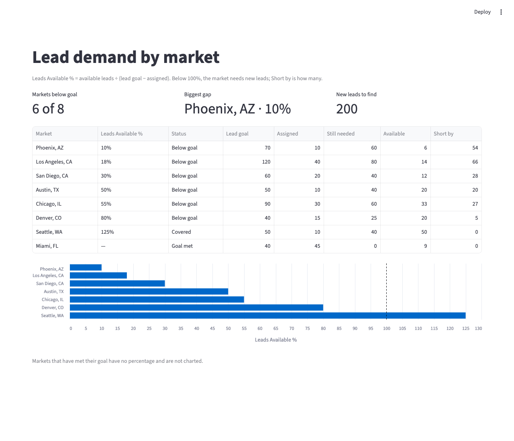

# Lead-gen agent

[](https://github.com/austinsolomon/applied_AI_portfolio/actions/workflows/ci.yml)

A Claude Agent SDK agent that does the job of a lead-generation operator. It reads a demand dashboard, finds the
markets furthest below their lead goal, plans the scrapes, and asks a human to approve the plan and a budget once.
From there it runs unattended: sources businesses from Google Maps and Exa, drops leads already in the CRM, enriches
contact details, qualifies each lead against a category rubric with cited evidence, and writes qualified leads to
the CRM. Every decision is recorded for a recurring evaluation review.

The demo category is mobile and in-home massage providers in US markets.



## Status

| Milestone | State |
|---|---|
| Python package, pinned toolchain, lockfile | done |
| Lint, format and pre-commit hooks (incl. secret scanning) | done |
| Tests and continuous integration | done |
| Container image | planned |
| Database plumbing: local Postgres, typed config, migrations | done |
| CRM schema, demand gaps, demo data | done |
| Demand dashboard | done |
| Raw agent loop on the Claude API | done |
| Sourcing, dedupe, enrichment, qualification, CRM write | planned |
| Orchestrator agent, approval, budget guard, evals | planned |
| Scheduled cloud deployment | planned |

## Quickstart

Requires [uv](https://docs.astral.sh/uv/) (it installs the pinned Python version itself) and Docker.

```bash
cd p1_leadgen_pipeline_hardened_agent
uv sync                       # create .venv from uv.lock
docker compose up -d --wait db   # local Postgres 16 on 127.0.0.1:5433
cp .env.example .env          # DATABASE_URL for the local database
uv run leadgen db migrate     # apply schema migrations
uv run leadgen db seed-demo   # fictional markets and leads, into an empty database
uv run leadgen dashboard      # demand dashboard at http://localhost:8501
uv run pytest                 # tests, against throwaway databases on the same server
```

## Demand dashboard

Every market's Leads Available %, biggest gap first, read from the same `gap_view` the agent reads.
Columns go from the answer to how it is made: goal − assigned = still needed; available ÷ still needed
= Leads Available %; still needed − available = short by, the new leads that market needs.



## Raw agent loop

`leadgen ask "Which market should we source first, and why?"` runs an agent loop written by hand on
the Claude Messages API ([`raw_agent_loop.py`](src/leadgen/raw_agent_loop.py)), before any agent
framework is used, so each step is visible:

1. The request carries the question, one tool (`read_gaps`, which reads `gap_view`) and the JSON
   schema the final answer must follow.
2. When the model stops with `tool_use`, the loop runs the tool and sends the result back, matched
   by `tool_use_id`. An unknown tool or a failing tool goes back as an error result.
3. When it stops with `end_turn`, the answer is validated with pydantic. A refusal is reported, not
   parsed.

Guards: a turn cap (default 5), and a dollar cap (default $0.05) checked before every call against
the worst case for that call. Every call's tokens and dollars are written to `cost_ledger`.

This command is paid (it calls the Claude API) and needs `ANTHROPIC_API_KEY` in `.env`. The default
model is Claude Haiku 5.5; a run costs about $0.0003. Tests replay recorded runs instead, so the
test suite and CI never call the API.

```text
$ uv run leadgen ask "Which market should we source first, and why?"
{
  "market": "Phoenix, AZ",
  "leads_available_pct": 10,
  "short_by": 54,
  "reason": "Phoenix has the lowest share of leads available (10%) ..."
}

call 1: tool_use  in   823 · cache read     0 · out    28 tokens · $0.00010
call 2: end_turn  in  1153 · cache read     0 · out   162 tokens · $0.00020
run 3c4eb590-… on claude-haiku-5-5: $0.00029
```

The same question on Claude Opus 5.5 chose Los Angeles (largest absolute shortfall, 66) instead
of Phoenix (lowest share, 10%). The prompt does not say which measure "first" means; that is the
kind of ambiguity the eval suite will pin down.

## Development

One-time setup, from the repository root:

```bash
uv tool install pre-commit   # the hook runner, installed once per machine
pre-commit install           # run the checks on every git commit
```

Every commit then runs file hygiene checks, [gitleaks](https://github.com/gitleaks/gitleaks) secret scanning, and
ruff lint and format. Ruff runs through `uv run`, so the hook, the editor and CI use the version pinned in
`uv.lock`. To run the checks by hand:

```bash
uv run ruff check     # lint
uv run ruff format    # format
uv run pytest         # tests (needs the database from the quickstart)
pre-commit run --all-files
```

On GitHub, CI runs on every pull request and every push to `main`: install from the lockfile (failing if
`uv.lock` is out of date), the same commit checks, a secret scan of the full git history, migrations
against a fresh Postgres service container, and the tests.

### Database

Configuration is typed: `DATABASE_URL` must be a Postgres URL, or the command stops at startup with a
message saying how to fix it. Schema changes are numbered SQL files in `src/leadgen/migrations/`,
applied in order by `leadgen db migrate`. Each file runs once, in its own transaction, and is recorded
with a checksum; the runner refuses to continue if an applied file was edited or if the database has
migrations the code does not know about. Tests create a throwaway database per test and drop it
afterwards.

The CRM enforces its own rules: phone, email and website are normalized by Postgres (generated
columns), so `(310) 555-0142` and `+1 310.555.0142` are the same lead and the second is rejected;
every lead needs a phone or an email; statuses and sources are fixed lists. `gap_view` computes
Leads Available % per market, and `read_gaps()` returns the markets below 100%, biggest gap first.

The demo data is fictional and deterministic: eight real US markets, invented massage businesses on
`.example` domains, and phone numbers in the 555-0100 to 555-0199 range reserved for fiction.

## Design

The full design, including the trade-offs behind each choice, is in [docs/design.md](docs/design.md). In short:

- **Claude Agent SDK, not a hosted agent platform**, so the loop, approval, budget, state and scheduling are
  built and understood here, and cost stays fully controlled.
- **One human decision per run.** After approval, a pre-tool-use hook blocks any action outside the approved plan or
  budget instead of asking again.
- **One Postgres database** serves as CRM, plan store, run state, job queue, page cache, cost ledger and eval log.
- **Agents only where reasoning is needed.** Contact enrichment is a plain API call. Qualification is one
  structured-output model call over gathered evidence, and escalates to an agentic research loop only when the
  evidence is unclear.
