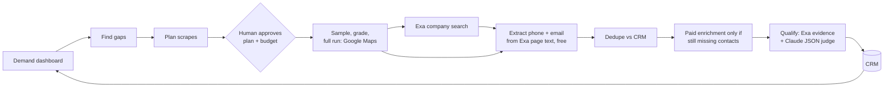
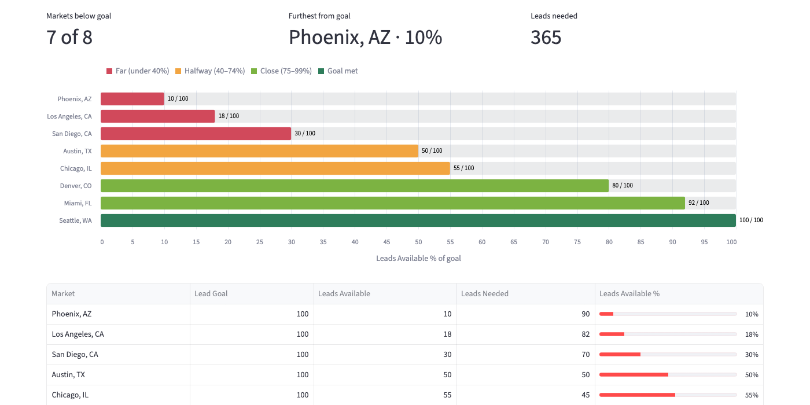

# Lead-gen agent

[](https://github.com/austinsolomon/applied_AI_portfolio/actions/workflows/ci.yml)

A Claude Agent SDK agent that does the job of a lead-generation operator. It reads a demand dashboard, finds the
markets furthest below their lead goal, plans the scrapes, and asks a human to approve the plan and a budget once.
From there it runs unattended: sources businesses from Google Maps and Exa, drops leads already in the CRM, enriches
contact details, qualifies each lead against a category rubric with cited evidence, and writes qualified leads to
the CRM.

**Exa is central to the pipeline:** plain-language Exa searches find the businesses, and Exa supplies
the page text Claude must quote to qualify a lead. See [Why Exa](#why-exa). Every decision is recorded for a recurring evaluation review.

The demo category is independent private chefs in US markets: chefs who cook in
clients' homes, rentals and private events. A chef currently tied to a restaurant, catering
company or meal-delivery business is rejected. Past restaurant experience is fine.

Explore the [three connected architecture diagrams](docs/architecture/README.md): the lead
pipeline, production safeguards, and qualification with human review. Each opens into focused
chapters, component details and inspectable data flows.



## Why Exa

Exa does two jobs in this pipeline, through Exa `search` and `get_contents`. Claude only reasons
over what Exa returns.

| Exa role | Pipeline stage | Exa call | What it gives the pipeline |
|---|---|---|---|
| **1. Find businesses** | Sourcing | `search("<plain-language description> in <city>", type="auto", category="company", num_results=25, exclude_domains=<directories>, contents={"text": ...})` per phrasing and city | Business homepages, with their page text cached for qualification |
| **2. Gather evidence** | Qualification and research | `get_contents(homepage)`, `search(..., include_domains=[the business's site])` and one open `search` | Page text the judge must quote from to qualify a lead |

Why it fits this category: Google Maps finds businesses by keyword and location, but most
private chefs have no storefront. They cook in clients' homes, so many have no Maps listing, and
the ones that do sit beside restaurants. What they do have is their own website, which is what Exa
indexes and matches on meaning.

- **Plain-language queries, as Exa recommends.** `config/category.yaml` holds a few
  descriptions of the business wanted, for example "independent private chefs who cook in
  clients' homes in {city}, personal chef business homepages". Each runs once per planned city with
  `type="auto"` and `category="company"`. Directories and shared platforms (Yelp,
  Take a Chef, Instagram) are excluded in the request and filtered again locally.
- **Query consensus as a confidence signal.** A business found by several phrasings is more
  likely to fit. The count is stored on each lead. Enrichment and qualification process
  high-consensus leads first, so they survive a budget or target cutoff, and every judge decision
  records the count.
- **Evidence arrives with the lead.** Each result's page text is cached when it is sourced, so
  qualification usually reads the homepage without another request. It then searches the
  business's own site (`include_domains`) instead of guessing `/services` or `/about` pages.
- **Evidence the judge can cite.** Search results carry 1,500 characters of page text and pages
  carry 6,000, so the judge's quote is checked against text Exa returned. Claude returns
  schema-validated JSON (`messages.parse` with a strict Pydantic model). A qualified verdict must
  quote that evidence word for word, or it is downgraded to review.
- **Firecrawl only renders.** When Exa has no text for a page (typically a JavaScript-built
  site), that one page is fetched with Firecrawl. Exa searches and Exa outages never fall back.
- **Cost stays visible.** Each Exa request reserves a ceiling (0.03 USD for a 25-result sourcing
  search) and records Exa's reported `cost_dollars`. Observed prices: 0.004 USD for a 10-result
  search without text, 0.007 USD with text, about 0.0001 USD per page of contents.

Live Phoenix comparison, same plan and market (run `f2423f88`, 2026-11-04). Details are in
[sample run](docs/sample_run.md#exa-live-run--2026-11-04).

| Source | Sourced | New after dedupe | Judged | Qualified | Qualified ÷ judged | Sourcing cost (USD) | Sourcing cost per qualified lead |
|---|---:|---:|---:|---:|---:|---:|---:|
| Google Maps | 18 | 15 | 15 | 2 | 13% | 0.0002* | — |
| Exa (seed lookalikes)† | 37 | 37 | 35 | 11 | 31% | 0.024 | 0.0022 |

\* Apify's reported usage had not settled when it was recorded, so the Maps figure is understated.
The 2026-10-11 Maps run cost 0.2002 USD for 50 businesses.
† This run used the earlier seed-lookalike sourcing (`find_similar` on 6 qualified leads). Exa has
since dropped `find_similar` from its docs, and sourcing now uses plain-language company search;
its first live run will replace this row.

## Status

| Milestone | State |
|---|---|
| Python package, pinned toolchain, lockfile | done |
| Lint, format and pre-commit hooks (incl. secret scanning) | done |
| Tests and continuous integration | done |
| Container image: python-slim + locked deps + Claude Code CLI, built and run in CI | done |
| Database plumbing: local Postgres, typed config, migrations | done |
| CRM schema, demand gaps, demo data | done |
| Dashboard: gaps, current run, history, sources, evals | done |
| Raw agent loop on the Claude API | done |
| US Census places and market expansion | done |
| Scrape plans, the one approval, run state (nothing runs twice) | done |
| Category config and dedupe against the CRM | done |
| Contact enrichment (BlitzAPI): cached per domain, every call in the cost ledger | done |
| Web search and page fetching with a page cache (Exa evidence, Firecrawl rendering only) | done |
| Job queue and worker pool (`cell_jobs`, `FOR UPDATE SKIP LOCKED`, jittered retries) | done |
| Maps and Exa sourcing, qualification with inline research, CRM write | done; live runs verified end to end (2026-11-05, massage category); private-chef category not yet run live |
| Eval capture, weekly review page, labels exported as test fixtures | done |
| SDK orchestrator, terminal approval, budget reservations and traces | done; live recovery and no-spend rerun verified |
| Unattended weekly run approved by a standing policy (`leadgen weekly`) | done; tested with fake providers |
| Scheduled cloud deployment | planned |

## Quickstart

Requires [uv](https://docs.astral.sh/uv/) (it installs the pinned Python version itself) and Docker.

```bash
cd p1_leadgen_pipeline_hardened_agent
uv sync                       # create .venv from uv.lock
docker compose up -d --wait db   # local Postgres 16 on 127.0.0.1:5433
cp .env.example .env          # DATABASE_URL for the local database
uv run leadgen db migrate     # apply schema migrations
uv run leadgen db seed-demo   # fictional markets and leads, into an empty database
uv run leadgen db load-places # US Census places (2020), the city list markets expand into
uv run leadgen dashboard      # gaps, current run, history, sources, evals at http://localhost:8501
uv run leadgen evals review   # weekly eval review page: label the pipeline's decisions
uv run pytest                 # tests, against throwaway databases on the same server
```

## Approved pipeline runs

```bash
uv run leadgen plan --target 50 --max-cities 1 --max-keywords 1 --budget-usd 5
uv run leadgen run --plan latest
```

Add `--audit` to both commands to record a verbose audit trail of that execution: one row per step
(planner reads, the approval, Agent SDK tool calls and hook decisions, budget reservations, every
provider request and response, cache hits, job claims, checkpoints, CRM writes), read in the
dashboard's Audit log tab while the run executes. It is off by default.

The planner selects the market with the lowest available-lead coverage, expands it using Census
places, and displays its cells and Maps and Exa ceilings before asking for one approval. The total budget
covers all services. `--approve --approved-by NAME` records approval already given by an operator.
The runner exposes only the next pipeline stage to the SDK: Maps, Exa, contact extraction,
dedupe, enrichment, qualification and CRM writing. When the judge cannot decide a lead
confidently (verdict `review`), the same qualification job escalates that lead to a bounded
research agent at once, starting from the evidence already gathered, and the judge decides
again; there is no separate research stage.

Contact extraction reads the phone numbers and emails printed on page text Exa sourcing already
cached, with no network call, so Exa leads reach dedupe with the same phone and email keys Maps
leads carry. Dedupe then matches on place ID, phone, email and domain, and paid enrichment
(BlitzAPI) runs only for new leads that still have neither.

Apify is polled and aborted after ten unique businesses or the sample ceiling; a poll can return
more than ten. Category purity and market distance gate continuation to the approved target.
Every partial dataset is persisted. Exa runs each
plain-language query phrasing once per planned city. The plan shows the Exa cap (searches × 0.03
USD) next to the Maps cap. Existing
contact details avoid an unnecessary Blitz lookup. Two workers process enrichment and four process qualification, with one paid attempt per job. Qualified results must cite an exact evidence quote,
a supplied source URL, an eligible service, and an affirmative service area.

Budget reservations are serialized in Postgres before paid work starts. Spend is counted across
all attempts of the same plan. Model operations have a separate 0.75 USD plan allowance, small SDK
session caps and output/turn limits. An uncertain call retains its reservation after failure.
A completed plan returns its recorded summary when run again. Failed runs require provider
reconciliation before `leadgen run --plan ID --resume`; see [operations](docs/operations.md).
The SDK session cap is an estimated stop threshold; it is not a provider billing guarantee.

Live services require the keys shown in `.env.example`. Tests use fakes and replay, reject external
socket connections, and create disposable Postgres databases. The live sample and provider
reconciliation are documented in [sample run](docs/sample_run.md).

The Phoenix sample sourced 50 businesses, qualified 12 and saved 10 with usable contacts. The
ledger total was 1.385297 USD, including 0.374400 USD of conservative web estimates; Anthropic
accounted for 0.097097 USD. Twenty-four businesses remain for human review. Exact Firecrawl
invoice reconciliation and cloud deployment remain open.

## Unattended weekly run

```bash
uv run leadgen weekly --dry-run   # what the policy would approve: market, cities, ceilings; spends nothing
uv run leadgen weekly --audit     # plan, approve by policy and run every stage, no person in the loop
```

`leadgen weekly` replaces the one human approval with a standing policy,
[`config/weekly_policy.yaml`](config/weekly_policy.yaml): total budget per run, plan size, an
optional pinned market, and a minimum number of days between runs. It then:

1. Refuses to start if migrations are not applied, a run is still marked running, or any paid
   call has an unknown outcome. Those need a person ([operations](docs/operations.md)).
2. Does nothing if a policy-approved plan already ran within `min_days_between_runs`, or if
   every market is at its goal.
3. Builds the plan for the biggest gap (or the pinned market) and refuses it if the Maps and
   Exa ceilings leave no room under the policy budget.
4. Approves it as `policy:weekly@<policy file sha>` through the same approval path a person
   uses, so the audit trail names the policy version. The pre-tool-use hook and budget
   reservations enforce that budget on every paid call, exactly as for a human approval.
5. Runs every stage through the Agent SDK orchestrator, the same path as `leadgen run`.
6. Prints a JSON summary (run, market, sourced by source, duplicates, verdicts, CRM inserts,
   spend by service vs budget), stores it in `traces`, and posts it to `SLACK_WEBHOOK_URL` if
   that is set. A failed post never fails the run.

| Exit code | Meaning |
|---|---|
| 0 | Ran to completion (or the dry run fits the policy) |
| 1 | The run started and failed; inspect the summary and traces |
| 2 | Nothing to do: already ran this cadence, or every market is at goal |
| 3 | Needs a person: unapplied migrations, unreconciled paid calls, or a plan over policy |

The exit codes let a scheduler such as cron or Cloud Scheduler tell these cases apart.

## Dashboard

`leadgen dashboard` opens seven tabs, all read through the same functions the pipeline uses. The
page is styled after Exa's public brand guidelines (Exa blue #1840ED on Marble #FAF9F8, a flared
serif for headings and a geometric sans for text, as free lookalikes of Exa's commercial
typefaces) through one theme file, [`exa_theme.toml`](src/leadgen/exa_theme.toml). It uses no Exa
logo and implies no endorsement.

| Tab | Shows |
|---|---|
| Demand gaps | Leads Available % per market, biggest gap first |
| Current run | The seven stages in order, each done, running, failed, waiting or "needs a human", with stage results, job progress, spend vs budget and recent events; refreshes every 10 s |
| Audit log | For a plan run with `--audit`: every step of the execution as Who (X) → Does (Y) → To (Z), for example "Exa stage → sends company search '…' → Exa API" or "PreToolUse hook → allows the tool call → Agent SDK"; filter by actor, search, newest first; refreshes every 5 s |
| Run history | One row per run: market, status, Maps and Exa sourced, new, qualified, review, rejected, CRM inserted, spend vs budget, cost per qualified lead |
| Sources and spend | Qualification rate per source, Exa query-consensus breakdown, spend per service (provider-reported vs estimated) |
| Eval review | Label the pipeline's decisions; labels export as test fixtures |
| Data model | Every Postgres table and view: one sentence on what it holds, its live row count, and a few made-up example rows |

Only the Eval review tab writes, and only labels. The page shows contact details and evidence, so
it is for local use.

The Demand gaps tab reads the same `gap_view` the agent reads. Every demo market has a goal of
100 leads. A progress bar per market shows how close it is, coloured far (under 40%), halfway
(40–74%), close (75–99%) or goal met, furthest first. The table has four numbers: Lead Goal,
Leads Available, Leads Needed (goal − available) and Leads Available % (available ÷ goal).
Assigned and converted leads do not count toward the goal.



## Raw agent loop

`leadgen ask "Which market should we source first, and why?"` runs an agent loop written by hand on
the Claude Messages API ([`raw_agent_loop.py`](src/leadgen/raw_agent_loop.py)), before any agent
framework is used, so each step is visible:

1. The request carries the question, one tool (`read_gaps`, which reads `gap_view`) and the JSON
   schema the final answer must follow.
2. When the model stops with `tool_use`, the loop runs the tool and sends the result back, matched
   by `tool_use_id`. An unknown tool or a failing tool goes back as an error result.
3. When it stops with `end_turn`, the answer is validated with pydantic. A refusal is reported, not
   parsed.

Guards: a turn cap (default 5), and a dollar cap (default $0.05) checked before every call against
the worst case for that call. Every call's tokens and dollars are written to `cost_ledger`.

This command is paid (it calls the Claude API) and needs `ANTHROPIC_API_KEY` in `.env`. The default
model is Claude Haiku 5.5; a run costs about $0.0003. Tests replay recorded runs instead, so the
test suite and CI never call the API.

```text
$ uv run leadgen ask "Which market should we source first, and why?"
{
  "market": "Phoenix, AZ",
  "leads_available_pct": 10,
  "short_by": 54,
  "reason": "Phoenix has the lowest share of leads available (10%) ..."
}

call 1: tool_use  in   823 · cache read     0 · out    28 tokens · $0.00010
call 2: end_turn  in  1153 · cache read     0 · out   162 tokens · $0.00020
run 3c4eb590-… on claude-haiku-5-5: $0.00029
```

The same question on Claude Opus 5.5 chose Los Angeles (largest absolute shortfall, 66) instead
of Phoenix (lowest share, 10%). The prompt does not say which measure "first" means; that is the
kind of ambiguity the eval suite will pin down.

## Eval capture and review

Every automated decision the pipeline makes is a row in `eval_records`: a sample grader's verdict
on a scrape cell, the judge's decision on one lead, a contradiction found at CRM write. The
pipeline writes them through `record_eval` ([`eval_review.py`](src/leadgen/eval_review.py)) with
the evidence behind the decision, enough to replay it. Once a week, `leadgen evals review` opens
a page that lists them newest first, filtered by kind or to the unlabeled ones; each gets a label,
correct or incorrect, and a note in `eval_labels`. Relabeling replaces the earlier label; the
record itself never changes, so a fixture always shows what the pipeline actually decided.
`leadgen evals export-fixtures` writes the labeled records to `tests/fixtures/evals/<kind>.json`,
sorted by id and stably formatted, so a reviewed mistake becomes a regression test and a re-export
is a readable diff.

## Contact enrichment

`leadgen enrich https://www.saffron-table.example` looks up a phone and an email for the business
behind a website ([`contacts.py`](src/leadgen/contacts.py)). It is a plain function with a fixed
input and output, not an agent. BlitzAPI keys its data on LinkedIn, so one lookup is a short
fixed chain, each step one HTTP call, stopping at the first step that finds nothing: domain →
company LinkedIn page → the best-placed person (owner or founder first) → verified work email →
direct phone (skipped when the key's plan has no phone endpoint).

The result, found or not, is cached in `contact_cache` by domain, normalized with the same
expressions as the CRM's `website_domain` column, so the two keys can never disagree; a domain
younger than 90 days in the cache costs nothing. Every metered call writes a `cost_ledger` row
with the records BlitzAPI reports it used, as it happens, so an aborted lookup still has its spend
recorded and the ledger can be reconciled against the provider's own usage. Rate limits and
server errors are retried with jittered backoff; timeouts are not retried, because the provider
may already have billed the request. Bad keys, exhausted plans and rejected requests come back
as plain messages.

This command is paid and needs `BLITZ_API_KEY` in `.env`. Tests fake every BlitzAPI endpoint
with [respx](https://github.com/lundberg/respx), so the suite and CI never call it.

## Web search and page fetching

Qualification needs evidence from the web. [`web_research.py`](src/leadgen/web_research.py) puts
that behind two calls, `search(query)` and `fetch_page(url)`, with three backends:

- **Exa** (`EXA_API_KEY` set, the default): `search` with page text per result, and
  `get_contents` for pages. Every call is written to `cost_ledger` as service `exa` with Exa's
  reported `cost_dollars`. A rate-limited call (HTTP 429, not billed) is retried twice.
- **Firecrawl** (`FIRECRAWL_API_KEY` set): with Exa, used only for a page Exa returned no text
  for, since Firecrawl renders JavaScript. Without an Exa key it is the main backend, as before:
  `/v2/search` and `/v2/scrape`, ledgered at credits × `FIRECRAWL_USD_PER_CREDIT`.
- **Free** (no key, and the test backend): httpx plus [trafilatura](https://trafilatura.readthedocs.io/)
  for a page's main text, and DuckDuckGo's HTML results page for search.

Fetched pages land in the `page_cache` table; a URL fetched in the last seven days is served from
Postgres with no network call and no charge. A rejected key or an empty credit balance is reported
as a plain message, so a configuration problem is never hidden. Tests fake every backend, so
neither the test suite nor CI touches the network.

```bash
uv run leadgen web search "private chef Pasadena"          # top results
uv run leadgen web fetch https://example.com/services --free  # main text, cached
```

## Development

One-time setup, from the repository root:

```bash
uv tool install pre-commit   # the hook runner, installed once per machine
pre-commit install           # run the checks on every git commit
```

Every commit then runs file hygiene checks, [gitleaks](https://github.com/gitleaks/gitleaks) secret scanning, and
ruff lint and format. Ruff runs through `uv run`, so the hook, the editor and CI use the version pinned in
`uv.lock`. To run the checks by hand:

```bash
uv run ruff check     # lint
uv run ruff format    # format
uv run pytest         # tests (needs the database from the quickstart)
pre-commit run --all-files
```

On GitHub, CI runs on every pull request and every push to `main`: install from the lockfile (failing if
`uv.lock` is out of date), the same commit checks, a secret scan of the full git history, migrations
against a fresh Postgres service container, the tests, and the container image (built, then run to
print its version and to migrate a fresh database).

### Container image

`Dockerfile` builds one image for laptop, CI and cloud: `python:3.12-slim`, the package and its
dependencies installed from `uv.lock` (`uv sync --locked`), and the Claude Code CLI the Agent SDK
drives, at a pinned version. It runs as a non-root user, with `leadgen` as the entrypoint. The build
context is an allowlist (`.dockerignore`), so `.env` can never end up in a layer.

```bash
docker build -t leadgen .
docker run --rm leadgen --version
docker run --rm --env-file .env --network host leadgen db migrate   # Linux: reach a host Postgres
LEADGEN_CONTAINER_TESTS=1 uv run pytest tests/test_container.py       # also build and run the image
```

### Database

Configuration is typed: `DATABASE_URL` must be a Postgres URL, or the command stops at startup with a
message saying how to fix it. Schema changes are numbered SQL files in `src/leadgen/migrations/`,
applied in order by `leadgen db migrate`. Each file runs once, in its own transaction, and is recorded
with a checksum; the runner refuses to continue if an applied file was edited or if the database has
migrations the code does not know about. Tests create a throwaway database per test and drop it
afterwards.

The CRM enforces its own rules: phone, email and website are normalized by Postgres (generated
columns), so `(310) 555-0142` and `+1 310.555.0142` are the same lead and the second is rejected;
every lead needs a phone or an email; statuses and sources are fixed lists. `gap_view` computes
Leads Available % per market, and `read_gaps()` returns the markets below 100%, biggest gap first.

The demo data is fictional and deterministic: eight real US markets, invented private-chef businesses on
`.example` domains, and phone numbers in the 555-0100 to 555-0199 range reserved for fiction.

### Census places and market expansion

`leadgen db load-places` loads every US place with at least 5,000 people in the 2020 Census (6,752
rows) from a snapshot packaged with the code, `src/leadgen/data/us_places_2020.csv`. The snapshot
joins two public-domain Census Bureau sources by place GEOID: the 2020 Gazetteer (official names,
states, interior-point coordinates; it carries no population) and the TIGERweb Census 2020 service
(population per place). `scripts/build_places_snapshot.py` rebuilds it; loading is an upsert, so
running it again changes nothing.

`expand_market(market_id)` ([`places.py`](src/leadgen/places.py)) returns the places inside a
market's service radius, largest first, each labelled with its state (`Pasadena, CA`), with the
distance computed in SQL by a haversine function from the migration. Radius, population floor
(default 5,000) and count (default 40) are parameters. The city list comes from Census data, not
from a model, so it never contains invented or ambiguous towns: Kansas City, KS and Kansas City,
MO are two rows.

### Category config and dedupe

[`config/category.yaml`](config/category.yaml) describes the one category a deployment sources:
search keywords, an expected qualification rate for planning estimates, the eligibility rubric the
grader and judge read, and two host lists. `shared_hosts` are social profiles and link-in-bio
pages that many businesses share (instagram.com, linktr.ee); `aggregator_hosts` are directories
and booking marketplaces (yelp.com, vagaro.com). The file is validated on load
([`category_config.py`](src/leadgen/category_config.py)): a misspelt key, a duplicate keyword, a
rate outside (0, 1] or a host written with a scheme or path is refused, naming the field.

[`dedupe.py`](src/leadgen/dedupe.py) decides, for a batch of sourced leads in one query, which
ones the CRM already holds. Postgres computes each incoming lead's keys with the exact expressions
that generate `crm_leads`' key columns (a test checks the expressions are copied from the
migration verbatim), then matches on Google place ID, phone, email and website domain. A domain
on a shared or aggregator host never counts as a match: two businesses with Instagram pages are
not the same business. Each decision names the keys that matched, and the new leads go on to
enrichment; nothing is spent on a duplicate.

## Design

The full design, including the trade-offs behind each choice, is in [docs/design.md](docs/design.md). In short:

- **Claude Agent SDK, not a hosted agent platform**, so the loop, approval, budget, state and scheduling are
  built and understood here, and cost stays fully controlled.
- **One human decision per run.** After approval, a pre-tool-use hook blocks any action outside the approved plan or
  budget instead of asking again.
- **One Postgres database** serves as CRM, plan store, run state, job queue, page cache, cost ledger and eval log.
- **Agents only where reasoning is needed.** Contact enrichment is a plain API call. Qualification is one
  structured-output model call over gathered evidence, and escalates to an agentic research loop only when the
  evidence is unclear.
