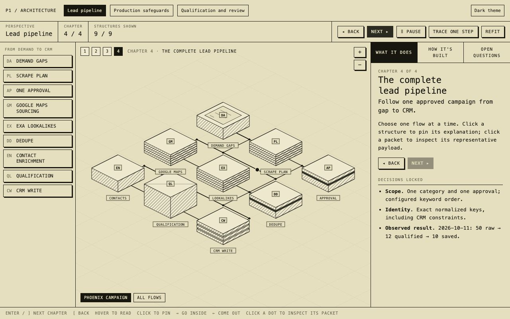

# Explore the architecture

Three connected maps explain the same application from different perspectives:

| View | Start here to understand |
|---|---|
| [Lead pipeline](index.html) | How demand becomes sourced, qualified and contactable CRM leads |
| [Production safeguards](safeguards.html) | How scope, spend, ownership and recovery are controlled |
| [Qualification and review](qualification.html) | How evidence becomes a decision, and uncertainty reaches human review |



Static previews: [production safeguards](images/safeguards.jpg) ·
[qualification and review](images/qualification.jpg). Use the HTML maps for exploration.

The maps are static HTML with no runtime dependencies or external requests. GitHub displays HTML
source, so open them locally in a browser or serve the project docs:

```bash
# From p1_leadgen_pipeline_hardened_agent/
python3 -m http.server 8767 --bind 127.0.0.1 --directory docs
```

Then visit **http://127.0.0.1:8767/architecture/**. Keep all three HTML files together for their
links to work. A static host can serve the same directory without an application server.

Use the perspective tabs at the top. Each map has four chapters, adding at most three components
at a time. Click a component to pin its explanation, follow a cross-view link, or **Go inside**
its execution steps. On the final chapter, select a flow and use **Trace one step** to inspect a
representative packet. Click a moving packet to pause it. Pan, zoom, and switch light/dark themes.

The pipeline cube in safeguards opens the stage map. Qualification opens the evidence map.
Shared components such as page cache link between views. Stores represent logical data roles in
one Postgres database, not separate services. Cloud deployment is visibly marked planned.

## Maintain the maps

| File | Purpose |
|---|---|
| `atlas/data.mjs` | Shared component catalog, view layouts, chapters, flows and decisions; edit content here |
| `atlas/template.html` | Adapted System Atlas renderer and cross-view navigation |
| `atlas/build.mjs` | Validates graph relationships and generates all outputs |
| `index.html`, `safeguards.html`, `qualification.html` | Generated interactive views |
| [SYSTEM.md](SYSTEM.md) | Generated text reference with the same components and decisions |
| [CONTEXT.md](CONTEXT.md) | Short glossary |

```bash
node docs/architecture/atlas/build.mjs
node docs/architecture/atlas/build.mjs --check
```

The check validates cross-view destinations, chapter visibility, flow endpoints, script syntax,
and generated-file freshness. CI runs it. Verify visual changes in a browser at desktop and
narrow widths, including component selection, packet selection, inside views and cross-view links.
Never hand-edit the generated HTML or `SYSTEM.md`.

Implementation baseline: `5ac8398`. Live numbers are dated 2026-10-11; packets are illustrative
and contain no business contact details. Existing implementation trade-offs remain in
[design.md](../design.md), and measured evidence remains in [sample_run.md](../sample_run.md).

## Attribution

Adapted from [inkboard/system-atlas](https://github.com/inkboard/system-atlas), upstream commit
`f7005f275861f5aa2faa8e7416b3d73d52d07338`, copyright 2026 Harshyt Goel, under the
[MIT license](atlas/LICENSE.system-atlas). The isometric renderer, component inspection,
packet animation and chapter controls come from that project. This adaptation adds three linked
perspectives, a shared catalog, stable component deep links, local theme controls, responsive
layout and generated-output checks. Fonts use the local monospace stack so the maps work offline.
