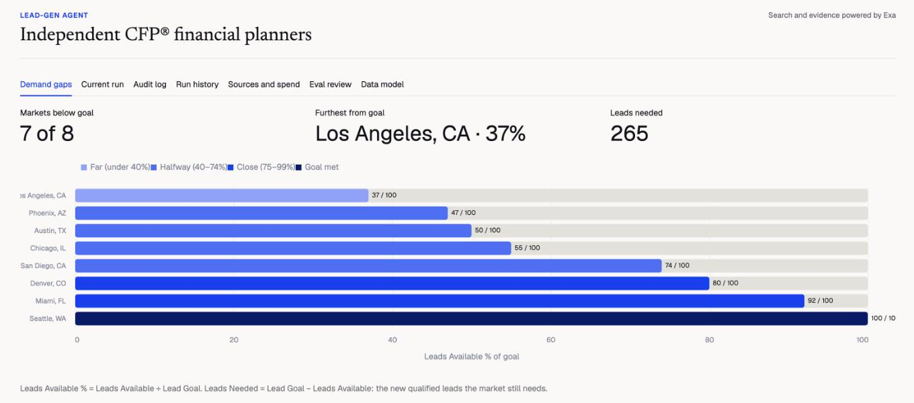
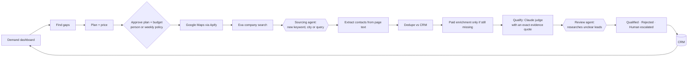
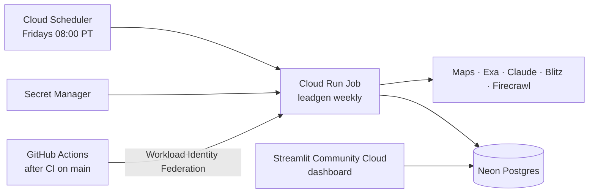

# Leadgen pipeline agents

[](https://github.com/austinsolomon/applied_AI_portfolio/actions/workflows/ci.yml)

An autonomous lead-generation pipeline that does the job of a lead-generation operator. It reads a
demand dashboard, finds the markets furthest below their lead goal, plans and prices the sourcing,
and gets one approval for the plan and budget. Then it runs unattended: it sources businesses from
Google Maps and Exa, drops leads already in the CRM, enriches contacts, qualifies each lead with
cited evidence, and writes qualified leads to the CRM. It runs weekly on Google Cloud.

The pipeline is deterministic Python that runs its stages in a fixed order. Two Claude Agent SDK
agents make only the decisions whose next step can't be known in advance.

The demo category is independent CFP® financial planners in US markets: firms with their own
website naming a planner who holds the CFP® certification. Advisors at national firms (Edward
Jones, Ameriprise and similar), insurance-only agencies, banks and directories are rejected. The
use case is selling software to planners: an independent firm picks its own software.



## How it works



## Where the agents decide

Everything with a known sequence is plain Python: planning, stage order, budget reservations,
dedupe, contact extraction, the judge (one structured Claude call whose quote is checked in code)
and the CRM write. The Claude Agent SDK is used for exactly two decisions, called from the
orchestrator as pipeline steps:

| Agent | Runs when | Decides | Limits (enforced by a PreToolUse hook and again in each tool) |
|---|---|---|---|
| Sourcing agent | Planned sourcing fell short, or a Maps sample graded poorly | A different Maps keyword or city, or a rewritten Exa search | The market's 10 largest cities and the category's keywords only; at most 2 Maps cells and 4 Exa searches; no repeats; budget reserved first; $0.05 of model spend |
| Review agent | The judge returned "review" | Which extra searches to run and pages to read; the judge then decides again | 4 calls; only pages its own searches found; $0.03 |

A run that meets its target with clean samples never starts the sourcing agent. Agent-added
sourcing is stored with `origin = 'agent'`, so every change is visible next to the approved plan.

## Why Exa

Exa does two jobs. It **finds businesses** with plain-language searches ("independent CFP®
financial planners offering retirement planning in {city}"), which match on meaning where a Maps
keyword mixes independent firms with national-firm branches. And it **supplies the evidence**:
page text cached at sourcing time, plus an on-site search, gives the judge text it must quote word
for word, or the verdict is downgraded to review. A business found by several phrasings gets a
higher consensus count and is processed first. Firecrawl is used only to render pages Exa has no
text for.

## Results

Three live runs for independent CFP® planners (Phoenix, Los Angeles, San Diego; the San Diego run
started on its own from Cloud Scheduler). Details in [sample run](docs/sample_run.md).

| Source | Sourced | New after dedupe | Qualified | Qualified ÷ judged | Written to CRM |
|---|---:|---:|---:|---:|---:|
| Google Maps | 365 | 300 | 61 | 20% | 58 |
| Exa company search | 117 | 102 | 43 | 42% | 42 |

**$9.72 total for 104 qualified leads (about $0.09 each, all services).**

## Production safeguards

| Safeguard | How |
|---|---|
| One approval, enforced everywhere | A person or a versioned standing policy approves the plan and budget; a stage gate checks order and budget before each stage |
| Nothing paid runs twice | Every paid call reserves its ceiling in Postgres first; a call with an unknown outcome keeps its reservation and blocks reruns until reconciled |
| Durable runs | Fixed stage loop with checkpoints; a job queue (`FOR UPDATE SKIP LOCKED`) so no two workers claim the same job; jittered retries |
| Cost visibility | Provider-reported cost recorded per call in a cost ledger; cost per qualified lead per run |
| Audit trail | Optional per-step audit log naming the approval, planner, stage gate, both agents' hook decisions, and every paid call |
| Evals | Human-labeled judge decisions on a weekly review page, exported as test fixtures; judge-alignment metrics |
| Quality gates | Lint, format, secret scanning, migrations, 500+ tests with faked providers (CI never spends) |

## Production deployment



- **Runs:** Cloud Scheduler starts the `leadgen-weekly` Cloud Run Job every Friday at 08:00
  Pacific. `leadgen weekly` plans for the biggest gap, approves it through the standing policy,
  runs every stage, and posts a summary to Slack. All state is in Postgres.
- **Database:** Neon Postgres with separate roles for the job (rows only), migrations (owner), and
  the dashboard (read-only views, or eval labels only for operators).
- **Secrets:** Google Secret Manager; none in GitHub.
- **Deploys:** after CI passes on `main`, GitHub Actions authenticates through Workload Identity
  Federation, builds the image, runs migrations, and points the weekly job at the new image.
- **Dashboard:** `streamlit_cloud/streamlit_app.py` on Streamlit Community Cloud.

## Dashboard

`leadgen dashboard` opens seven tabs: demand gaps, current run (live stage status, spend vs
budget), audit log, run history (cost per qualified lead per run), sources and spend, eval review
(blind labeling of judge decisions beside the evidence, with a judge-alignment panel), and the data
model.

## Run it locally

Requires [uv](https://docs.astral.sh/uv/) and Docker. From this folder:

```bash
uv sync
docker compose up -d --wait db     # local Postgres 16
cp .env.example .env
uv run leadgen db migrate
uv run leadgen db seed-demo        # fictional markets and leads
uv run leadgen db load-places      # US Census places
uv run leadgen dashboard           # http://localhost:8501
uv run pytest

uv run leadgen plan --target 50 --max-cities 1 --max-keywords 1 --budget-usd 5
uv run leadgen run --plan latest   # add --audit to both for a step-by-step audit trail
uv run leadgen weekly --dry-run    # what the standing policy would approve; spends nothing
```

Live runs need the keys in `.env.example`.

## Stack

Python, Postgres (Neon), Claude Agent SDK and Claude API structured outputs, Apify (Google Maps),
Exa, BlitzAPI, Firecrawl, Streamlit, Docker, Google Cloud Run, Cloud Scheduler, Secret Manager,
GitHub Actions.

## More

- [Architecture diagrams](docs/architecture/README.md): the pipeline, production safeguards, and
  qualification with human review
- [Design](docs/design.md) and [operations runbook](docs/operations.md)
- [Sample runs](docs/sample_run.md)
- [Migrations](src/leadgen/migrations/README.md)
