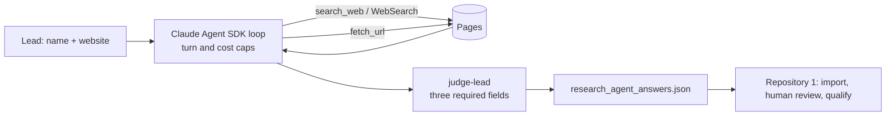

# Research agent, four frameworks

A research agent that answers one lead-enrichment question with cited evidence: **does this bakery
already take online orders?** The required build uses the Claude Agent SDK; alternate versions of
the same task in the Vercel AI SDK and the OpenAI SDK share the same fixtures, so the libraries can
be compared side by side. Built as Repository 2 of a course I wrote (Automation Academy, phase 6);
it plugs into [semi-automated leadgen skills](../semi-automated-leadgen-skills/), Repository 1.

## What it does

Given a bakery's name and website, the agent searches and reads pages until it can support an
answer, then returns three checked fields: whether the evidence supports "no online ordering", the
reason, and the kind of ordering platform. It is built to keep uncertainty honest:

- A homepage that says "Order Ahead" is not proof of a checkout, so the agent reads the next page,
  finds "call or email, pay at pickup", and cites it.
- When pages don't settle the question, the lead stays **unresolved** instead of being forced to
  yes or no.
- Research never qualifies a lead or sends a message. A person confirms the answer before it
  enters the pipeline.

## How it works



| File | Role |
|---|---|
| `claude_agent_sdk/worker/research-tools.ts` | Ordinary functions exposed as tools through an in-process MCP server |
| `claude_agent_sdk/worker/run-research.ts` | The SDK call, the tools, and the turn limits |
| `claude_agent_sdk/worker/judge-lead.ts` | Turns the research report into the three required fields |
| `scripts/demo.ts` | Runs the offline rehearsal and saves evidence keyed by Repository 1's lead IDs |
| `vercel_ai_sdk/`, `openai_sdk/` | The same task in two other libraries, tested against the same fixtures |
| `shared/` | Fixtures, the fixture contract, replay, and output validation used by every version |

## Offline first

`npm test` and `npm run demo` replay saved model choices and saved pages, so they run with no
account, key, or network. The real tool handlers, evidence files, validation, and import path all
run; only the live model loop is replaced. Expected demo output:

```text
Bluebird Bakery: 5 tool calls; supportsNoOnlineOrdering=true
Oak Street Bakes: 5 tool calls; supportsNoOnlineOrdering=false
Rye & Rosemary Bakery: 5 tool calls; supportsNoOnlineOrdering=true
Dos Rios Panaderia: 6 tool calls; supportsNoOnlineOrdering=false
```

The bakeries are fictional (`.example` domains), so the fixtures can't be researched live by
accident.

## Run it

Requires Node.js 22.6+.

```bash
npm ci
npm test
npm run demo                 # offline rehearsal, writes out/research_agent_answers.json

# optional live run on a real site (paid; capped at 12 turns / $0.25 for research, 3 turns / $0.10 for the answer check)
npm run research:live -- --allow-paid --company "Your bakery" --website "https://your-bakery.com"
```

To feed results into Repository 1, keep the two folders side by side and run its
`pipeline.import_research`, `pipeline.review_research`, and `pipeline.qualify` commands; the
imported answer only attaches evidence and never approves itself.

## Design choices

- **Code limits, not prompts, bound spend:** turn and dollar caps are enforced in code for both the
  research loop and the answer check.
- **Evidence over fluency:** every answer carries its source; unresolved is a valid result.
- **One task, several frameworks:** the same fixtures and validation make the libraries directly
  comparable. Hosting, queue and browser-tool sketches marked "illustrative" are design notes, not
  running services (see `OPTIONAL.md`).

Licensed for personal use only (see `LICENSE`).
