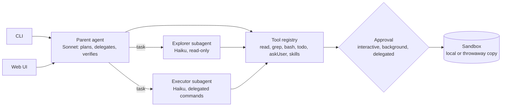

# Vercel coding harness (TeensyCode)

A coding-agent harness built from scratch, twice: once in TypeScript on the Vercel AI SDK and once
in Python on the Claude Agent SDK, kept in sync lesson by lesson. Built while working through
Vercel Academy's [Build Your Own AI Coding Agent Harness](https://vercel.com/academy/build-ai-agent-harness)
and extended past it. The Python version is the starting point for the [GTM agent](../../gtm_agent/).

A *harness* is everything around the model: which tools it can call, how its prompt is assembled,
where its commands run, how its context stays small, when a human approves, and how its work is
checked.

## What it does

Point it at a project folder and give it a task ("find all TODO comments", "add rate limiting to
the auth routes"). It plans, searches and reads the code, runs commands, delegates focused work to
subagents, verifies its changes, and streams its answer to the terminal or a local web UI.

## Architecture



| Concern | How it is handled |
|---|---|
| Tools | Each tool has a written contract (when to use, when not to, examples) and bounded output; registered in a tool registry rather than hard-coded |
| System prompt | Built at runtime from sections (agency, guardrails, ambiguity, verification) plus project facts and `AGENTS.md` |
| Sandbox | One interface, swappable backends: your real folder, or a throwaway copy (in-memory filesystem in TypeScript, temp copy in Python) |
| Context | Pruning and cache breakpoints in TypeScript; in Python the Agent SDK caches and compacts, and telemetry prices every step against an uncached baseline |
| Delegation | A `task` tool starts an explorer (read-only) or executor (runs only commands the parent hands down) with its own context window |
| Approval | Three modes: interactive (safe list runs, everything else asks), background (for CI), delegated (trusted commands passed to subagents); the web UI shows Approve and Deny buttons |
| Planning and verification | A todo tool, a grep-first reading policy, and a verification contract that only claims checks it actually ran |
| Extensibility | Skills with progressive disclosure (names in the prompt, content on demand) and custom tool registration |
| Observability | Token and cost lines per step, a token-budget dashboard and a live subagent panel in the web UI |

## Two stacks

| | `typescript-agent/` | `python-agent/` |
|---|---|---|
| Stack | Bun, AI SDK (`ToolLoopAgent`), Zod | Claude Agent SDK, Pydantic, FastAPI |
| Agent and tools | `index.ts`, `src/tools.ts` | `index.py`, `tools.py` |
| Prompt builder | `src/system.ts` | `system.py` |
| Web UI server | `server.ts` | `server.py` |
| Tests | `bun test` | `python test_system.py` |

The parent agent runs on Sonnet and both subagents on Haiku: the parent plans and follows the
verification contract, and the subagents do narrow, instruction-driven work.

## Run it

Both read `ANTHROPIC_API_KEY` from a `.env` file.

```bash
# TypeScript
cd typescript-agent && bun install
bun run index.ts .. "Find all TODO comments"
bun run dev                                   # web UI on :3000

# Python
cd python-agent && python3 -m venv .venv && .venv/bin/pip install -r requirements.txt
.venv/bin/python index.py .. "Find all TODO comments"
.venv/bin/python server.py .                  # web UI on :3000
```

Options: `--model=...` for the parent model, `SANDBOX=just-bash` (TypeScript) or
`SANDBOX=temp-copy` (Python) for a throwaway sandbox, and `APPROVAL_MODE=interactive|background|delegated`.

## Course coverage

| Module | Topic | Built |
|---|---|---|
| 1 | The agent loop: read, grep, bash with safety gates | Yes |
| 2 | Tool design: description contracts, factory pattern, approval modes | Yes |
| 3 | System prompt: structure, runtime construction, verification gates, `AGENTS.md` | Yes |
| 4 | Sandbox abstraction: interface, local and in-memory backends, lifecycle hooks | Yes (cloud backend designed, not built) |
| 5 | Context management: pruning, bounded output, cache control | Yes |
| 6 | Subagent delegation: explorer, executor, task tool | Yes |
| 7 | Sandbox lifecycle: state machine, snapshots, durable workflows | Planned in `python-agent/post-course-todos.md` |
| 8 | Human in the loop: structured questions, approval config | Yes (event layer planned in `module_11_todos.md`) |
| 9 | Planning and verification: todo tool, grep-first, verification contract | Yes |
| 10 | Surfaces: CLI, streaming, web UI | Yes |
| 11 | Extensibility: skills, tool registry, extension points | Yes (event bus planned) |

## Layout

```
typescript-agent/   Bun + AI SDK version, with skills/ and a web UI in public/
python-agent/       Claude Agent SDK version, with a web UI in public/ and post-course-todos.md
demo/               small fixture for search tests
module_11_todos.md  plan for the event layer behind approval
scripts/sync_course_build.sh  pulls new commits from the private course repo, without the course's lesson text
```

The course's lesson text stays in a private repository; `scripts/sync_course_build.sh` and the
repo's checks keep it out of this one.
