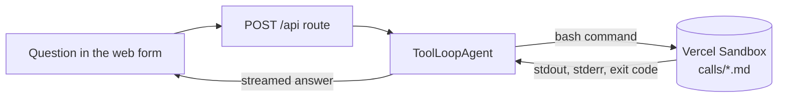

# Vercel filesystem agent

An agent that answers questions about sales-call transcripts by exploring them with bash inside an
isolated Vercel Sandbox. Built on Vercel Academy's
[Building Filesystem Agents](https://vercel.com/academy/filesystem-agents) course starter and
deployed on Vercel.

## What it does

You type a question about the customer calls, such as "Which customer raised pricing concerns?",
and the agent finds the answer by running commands like `ls`, `grep` and `cat` over the call
transcripts, then writes a reply from what it found. The answer streams into the page as it is
written.

## How it works



- **The loop:** an AI SDK `ToolLoopAgent` with one tool, `bashTool`. The model decides which
  command to run, reads the result, and repeats until it can answer.
- **The sandbox:** when the server starts, it creates one Vercel Sandbox and copies the transcripts
  from `lib/calls/` into it, so the agent's commands never touch the server's own filesystem.
- **The model:** called directly through the Anthropic provider (`ANTHROPIC_API_KEY`) instead of
  the course's AI Gateway.
- **Python references:** `lib/ref_agent.py`, `lib/ref_tools.py` and `app/api/ref_route.py` show the
  same agent, tool and route in Python for comparison.

## Files

| File | Role |
|---|---|
| `lib/agent.ts` | Creates the sandbox, loads the transcripts, defines the agent and its instructions |
| `lib/tools.ts` | The bash tool: runs a command in the sandbox and returns stdout, stderr and exit code |
| `app/api/route.ts` | Takes the latest user message and streams the agent's response |
| `app/page.tsx`, `app/form.tsx` | The question form and streamed answer |
| `lib/calls/*.md` | Three sample call transcripts |

## Run it

Requires Node.js 22+, pnpm, and the Vercel CLI.

```bash
pnpm install
vc link && vc env pull     # writes VERCEL_OIDC_TOKEN, which authenticates Vercel Sandbox
# add ANTHROPIC_API_KEY to .env.local
pnpm dev                   # http://localhost:3000
```

`VERCEL_OIDC_TOKEN` is short-lived; run `vc env pull` again if sandbox calls start failing with
authentication errors.

## Scope

This is the smallest possible agent: one loop, one tool, one sandbox. It has no approval step, no
saved state between requests, and every request shares the sandbox created at startup. Those are
the pieces the [coding harness](../vercel_coding_harness/) adds.
